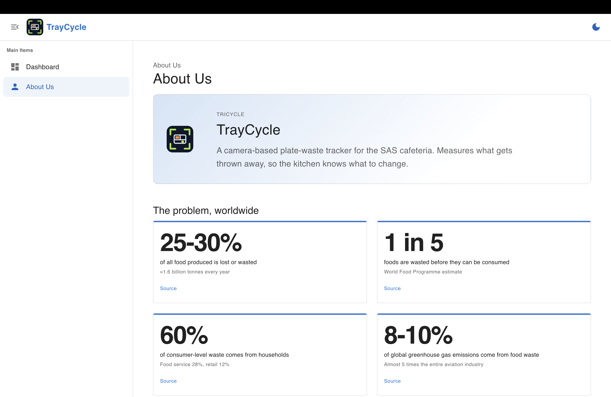

# TrayCycle

> By team TriCycle (Ian Xie, Gordon Ji, Aryan Mahajan), for 2026-2027 SAS CSHS Hackathon.

A camera-based food-waste tracker for the SAS cafeteria, presented measured waste in kg per dish plus a dashboard the kitchen can act on.

Connection to theme: [Google Docs](https://docs.google.com/document/d/1deMZ1dqA7uKFVp50j_QAB9uro-kUMkfiM3LVuQ0eOIQ/edit?usp=sharing)

Presentation slides: [Google Slides](https://docs.google.com/presentation/d/1yP6BdAPeri5FJA7uHaJRGIY7rOP3S1hKGzQTQR-aGcE/edit?usp=sharing)

Live site: [traycycle.org](https://traycycle.org)

## Preview



## Tech stack

### Frontend

- React — Framework
- MUI — UI library
- Vite — Build tool + dev server
- Axios — Handles API requests
- React Router — Client-side routing

### Backend

- Django — Base framework
- Django Rest Framework — RESTful APIs, viewsets, and serializers
- uv — Python dependencies management
- django-filter — Create dynamic filter rules in URL query parameters

**Management commands:**

1. `python manage.py create_worker`
   Create a new worker user and generate an authentication token.
   Args:
   `--username <name>`: Username for the worker user.
   `--group <name>`: Group to which the new user will be added.
   `--rotate-token`: Rotate the token if the user already exists.

2. `python manage.py seed_demo`
   Populate the database with fake demo data.
   Args:
   `--force`: Force the creation of demo data even if there are existing data. Existing data will be replaced.

<details>
<summary><b>Endpoints:</b></summary>

|       **Method**        |              **Endpoint**               |                   **Description**                    |    **Auth**     |
| :---------------------: | :-------------------------------------: | :--------------------------------------------------: | :-------------: |
|          POST           |          `/api/accounts/login`          |           Log in and obtain the auth token           |      None       |
|           GET           |           `/api/accounts/me`            |     Get the current authenticated user's profile     |  Authenticated  |
|           GET           |          `/api/wastes/health`           |                     Health check                     |      None       |
|        GET, POST        |         `/api/wastes/stations`          |               List or create stations                |      Staff      |
| GET, PUT, PATCH, DELETE |       `/api/wastes/stations/{id}`       |          Read, update, or delete a station           |      Staff      |
|        GET, POST        |          `/api/wastes/dishes`           |                List or create dishes                 |      Staff      |
| GET, PUT, PATCH, DELETE |        `/api/wastes/dishes/{id}`        |            Read, update, or delete a dish            |      Staff      |
|           GET           |           `/api/wastes/menus`           |                   List menu items                    | Staff or worker |
|           GET           |       `/api/wastes/menus/{date}`        |                Retrieve menu on a day                | Staff or worker |
|          POST           |           `/api/wastes/menus`           |                  Create menu items                   |      Staff      |
|   PUT, PATCH, DELETE    |       `/api/wastes/menus/{date}`        |         Update or delete a menu day instance         |      Staff      |
|        GET, POST        |          `/api/wastes/devices`          |                List or create devices                |      Staff      |
| GET, PUT, PATCH, DELETE |       `/api/wastes/devices/{id}`        |           Read, update, or delete a device           |      Staff      |
|          POST           | `/api/wastes/devices/{id}/rotate-token` |               Rotate a device's token                |      Staff      |
|           GET           |         `/api/wastes/captures`          |                    List captures                     |      Staff      |
|          POST           |         `/api/wastes/captures`          |                   Create a capture                   | Staff or device |
| GET, PUT, PATCH, DELETE |       `/api/wastes/captures/{id}`       |          Read, update, or delete a capture           |      Staff      |
|          POST           |      `/api/wastes/captures/claim`       |          Claim the next capture to process           | Staff or worker |
|          POST           |    `/api/wastes/captures/{id}/fail`     |               Set a capture as failed                | Staff or worker |
|           GET           |        `/api/wastes/predictions`        |                   List predictions                   |      Staff      |
|           GET           |     `/api/wastes/predictions/{id}`      |                  Read a prediction                   |      Staff      |
|          POST           |        `/api/wastes/predictions`        |                 Create a prediction                  | Staff or worker |
|        GET, POST        |          `/api/wastes/labels`           |                List or create labels                 |      Staff      |
| GET, PUT, PATCH, DELETE |        `/api/wastes/labels/{id}`        |           Read, update, or delete a label            |      Staff      |
|        GET, POST        |      `/api/wastes/overproduction`       |          List or create overproduction logs          |      Staff      |
| GET, PUT, PATCH, DELETE |    `/api/wastes/overproduction/{id}`    |    Read, update, or delete an overproduction log     |      Staff      |
|           GET           |           `/api/wastes/stats`           | Fetch prediction stats based on the provided filters |  Authenticated  |
|           GET           |         `/api/wastes/forecast`          |          Fetch forecast of waste data (WIP)          |      Staff      |

</details>

<details>
<summary><b>Example `/api/wastes/stats` return response:</b></summary>

```json
{
  "bowl_count": 5,
  "average_waste_percent": 35.0,
  "total_waste_kg": 0.6,
  "average_waste_kg": 0.12,
  "daily": [
    {
      "date": "2025-12-01",
      "bowl_count": 1,
      "average_waste_percent": 25.0,
      "total_waste_kg": 0.062,
      "average_waste_kg": 0.062
    },
    {
      "date": "2025-12-02",
      "bowl_count": 1,
      "average_waste_percent": 0.0,
      "total_waste_kg": 0.0,
      "average_waste_kg": 0.0
    },
    {
      "date": "2025-12-03",
      "bowl_count": 1,
      "average_waste_percent": 75.0,
      "total_waste_kg": 0.263,
      "average_waste_kg": 0.263
    },
    {
      "date": "2025-12-04",
      "bowl_count": 1,
      "average_waste_percent": 50.0,
      "total_waste_kg": 0.2,
      "average_waste_kg": 0.2
    },
    {
      "date": "2025-12-05",
      "bowl_count": 1,
      "average_waste_percent": 25.0,
      "total_waste_kg": 0.075,
      "average_waste_kg": 0.075
    }
  ],
  "dishes": [
    {
      "dish_id": 14,
      "dish_name": "Beef Bulgogi",
      "bowl_count": 1,
      "average_waste_percent": 75.0,
      "total_waste_kg": 0.263,
      "average_waste_kg": 0.263,
      "daily": [
        {
          "date": "2025-12-03",
          "bowl_count": 1,
          "average_waste_percent": 75.0,
          "total_waste_kg": 0.263,
          "average_waste_kg": 0.263
        }
      ],
      "waste_bucket_distribution": {
        "75": 1
      }
    },
    {
      "dish_id": 18,
      "dish_name": "Hainanese Chicken Rice",
      "bowl_count": 1,
      "average_waste_percent": 50.0,
      "total_waste_kg": 0.2,
      "average_waste_kg": 0.2,
      "daily": [
        {
          "date": "2025-12-04",
          "bowl_count": 1,
          "average_waste_percent": 50.0,
          "total_waste_kg": 0.2,
          "average_waste_kg": 0.2
        }
      ],
      "waste_bucket_distribution": {
        "50": 1
      }
    },
    {
      "dish_id": 15,
      "dish_name": "Sweet and sour pork",
      "bowl_count": 1,
      "average_waste_percent": 25.0,
      "total_waste_kg": 0.075,
      "average_waste_kg": 0.075,
      "daily": [
        {
          "date": "2025-12-05",
          "bowl_count": 1,
          "average_waste_percent": 25.0,
          "total_waste_kg": 0.075,
          "average_waste_kg": 0.075
        }
      ],
      "waste_bucket_distribution": {
        "25": 1
      }
    },
    {
      "dish_id": 13,
      "dish_name": "Chicken Teriyaki",
      "bowl_count": 1,
      "average_waste_percent": 25.0,
      "total_waste_kg": 0.062,
      "average_waste_kg": 0.062,
      "daily": [
        {
          "date": "2025-12-01",
          "bowl_count": 1,
          "average_waste_percent": 25.0,
          "total_waste_kg": 0.062,
          "average_waste_kg": 0.062
        }
      ],
      "waste_bucket_distribution": {
        "25": 1
      }
    },
    {
      "dish_id": 16,
      "dish_name": "Caesar Salad",
      "bowl_count": 1,
      "average_waste_percent": 0.0,
      "total_waste_kg": 0.0,
      "average_waste_kg": 0.0,
      "daily": [
        {
          "date": "2025-12-02",
          "bowl_count": 1,
          "average_waste_percent": 0.0,
          "total_waste_kg": 0.0,
          "average_waste_kg": 0.0
        }
      ],
      "waste_bucket_distribution": {
        "0": 1
      }
    }
  ]
}
```

</details>

### Raspberry Pi 5 Image Capture

WIP

### Database & Media Storage

#### Development

- SQLite3 — Simple database
- Local `MEDIA_ROOT` — Local media file storage

#### Production

- PostgreSQL — Object-relational database management system
- Cloudflare R2 — Near free, unstructured data storage system

## Development

### Frontend

```bash
cd frontend
npm install  # install the necessary dependencies
npm run dev
```

The frontend uses React and typescript, with Vite for deployment and builds, Material UI for interface components, and Toolpad Core as the dashboard layout. API requests uses Axios.

Note that it assumes that Django runs on 8000 and is running for backend features. Restart Vite after changing environment variables. VITE is exposed to frontend code so do not put secrets into it.

Note that the upload function was removed because our school banned phones :sob:.

### Backend

```bash
cd backend
uv sync  # sync the virtual environment
uv run python manage.py migrate  # migrate database
uv run python manage.py runserver
```

### Database & Media Storage

You do not need a separate database or media storage for local development. The built-in SQLite3 in Django will work fine, and media files will be stored in your `MEDIA_ROOT`.

## GitHub Actions

The GitHub Actions CI/CD has 4 jobs:

1. Backend lint: run ruff lint and format checks
2. Backend tests: run Django tests
3. Backend migration upgrade: apply pull request and target branch migration
4. Frontend lint: run ESLint, Prettier, and npm build

To run CI locally, use the command `make ci-local`; to run checks individually, use the following commands:

```bash
make lint  # lint code
make test  # run tests
make format-check  # check code formatting
```

## Deployment

The frontend, backend, and PostgreSQL database are deployed on [Render](https://www.render.com). The media storage and custom domain are bought from [Cloudflare](https://www.cloudflare.com).

- Frontend: a free static site
- Backend: a 0.5 CPU 512 MB RAM web service
- Database: 0.1 CPU 256 MB 10GB PostgreSQL service
- Media storage: Cloudflare R2 object storage service

## License

[MIT](LICENSE)
